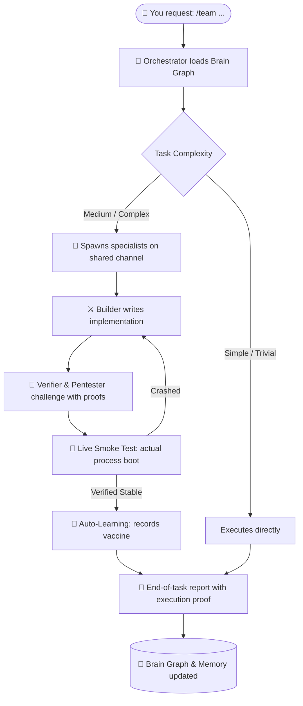

<div align="center">

[English](README.en.md) | [Italiano](README.md)

# 🧭 team-workflow

**An autonomous team of specialist AI agents inside your coding assistant.**<br>
Persistent Brain Graph Memory · "Zero Fake-Solved" Live Runtime Verification · Auto-learning & Preventive Vaccines · Adversarial Shared Channel · Transparent End-of-Task Report.

[](https://github.com/antoStr/team-workflow/releases)
[](https://github.com/antoStr/team-workflow/actions/workflows/tests.yml)
[](LICENSE)

-supported-4285f4)


</div>

---

## 📑 Table of Contents

1. [Overview](#-overview)
2. [Why Use It](#-why-use-it)
3. [What's New in v2.0](#-whats-new-in-v20)
4. [How It Works](#️-how-it-works)
5. [Installation](#-installation)
6. [The Universal `/team` Command & First 5 Minutes](#-the-universal-team-command--first-5-minutes)
7. [Zero Fake-Solved: Live Smoke Test](#-zero-fake-solved-live-smoke-test)
8. [Auto-Learning & Preventive Vaccines](#-auto-learning--preventive-vaccines)
9. [Project Memory & Brain Graph](#-project-memory--brain-graph)
10. [Specialist Agents](#-specialist-agents)
11. [Collaborative Talk & Adversarial Gating](#-collaborative-talk--adversarial-gating)
12. [Skills Library](#-skills-library)
13. [Cybersecurity & Binary Reverse Engineering](#-cybersecurity--binary-reverse-engineering)
14. [Add-ons & MCP Servers](#-add-ons--mcp-servers)
15. [Zero-Token Upgrades](#-zero-token-upgrades)
16. [Costs & Budget Tracking](#-costs--budget-tracking)
17. [Frequently Asked Questions](#-frequently-asked-questions)
18. [Further Reading](#-further-reading)
19. [License](#-license)

---

## 💡 Overview

**team-workflow** is a universal plugin for **Claude Code**, **agy (Antigravity)**, **OpenCode**, and **Codex** (including **opencodex**).

Normally, you converse with a single generalist model that works alone, frequently claims bugs are fixed without ever launching the application, and forgets architecture context across sessions.

With **team-workflow**, your coding assistant becomes the **lead engineer of a specialized autonomous team**:
- Understands your goal and selects the right **specialist roles** (frontend, backend, pentester, reverse engineer, tester, reviewer, architect...).
- Maintains project memory using an Obsidian-compatible **Brain Knowledge Graph**.
- **Deterministically verifies at runtime** that the app or game compiles, boots, and runs stably without fatal crashes (**Zero Fake-Solved**).
- **Continuously learns** from previous mistakes and injects **anti-pattern vaccines** into future sessions.
- Delivers a structured **report with empirical evidence** and prompts for permission before any irreversible operation.

> [!TIP]
> **One command to rule them all**: simply type `/team <your task>` to mobilize the full team without needing to remember dozens of complex commands.

---

## ✨ Why Use It

| | Standard Assistant | With team-workflow v2.0 |
|---|---|---|
| 🧠 **Memory** | Session restarts from zero context | Persistent Knowledge Graph in `docs/brain/` with weekly compaction |
| 👥 **Expertise** | Single generalist assistant | **130 specialists**: core, languages, frameworks, offensive security, reversing & malware analysis |
| 🎮 **Real Verification** | "Problem solved!" (without launching) | **Zero Fake-Solved**: live runtime smoke test on actual process, exit code & logs |
| 🛡️ **Auto-Learning** | Repeats identical bugs over time | Records anti-patterns and injects **behavioral vaccines** on every prompt |
| ⚔️ **Quality Gate** | Author approves their own code | Adversarial gate: builder vs. verifier on a shared channel |
| ⚡ **Simplicity** | 25 distinct slash commands | **Universal `/team` command** for all workflows |
| 🔄 **Upgrades** | Manual steps or token-heavy prompts | Zero-token `/team upgrade` via local native script |
| 💰 **Budget & Rates** | Unpredictable token usage | Pre-task estimate, per-agent cost breakdown, integrated dashboard |

---

## 🚀 What's New in v2.0

- 🎯 **Universal `/team` Command**: just run `/team add oauth login`, `/team fix menu crash`, or `/team audit security`. Legacy commands remain fully supported as backwards-compatible aliases.
- 🚦 **Zero Fake-Solved Gate**: eliminates the classic AI hallucination where an agent declares success without testing. The engine runs `tw.py smoke "<cmd>"` with process watchdogs to guarantee boot stability.
- 💉 **Continuous Auto-Learning & Vaccines**: whenever a bug is fixed or an adversarial gate passes, `tw.py learn` captures the anti-pattern and injects it as an active vaccine into subsequent agent prompts.
- 🧠 **Brain Knowledge Graph**: Obsidian-compatible knowledge vault in `docs/brain/` with bidirectional wikilinks, YAML frontmatter, and `tw.py brain rollover` for weekly state compaction across long-running projects.
- 🛡️ **Cybersecurity Suite (Strix, Cloudflare & Malware Intel)**: 100 advanced security playbooks (42 Strix + 15 Cloudflare + 43 Malware Analysis & URL Threat Hunting), bringing the total library to **512 resources**.
- 🔬 **Pentester, Reverse Engineer & Malware Analyst Roles**: binary decompilation, malware triage, and static/dynamic audit supporting IDA Pro, Ghidra, x64dbg, Cutter, YARA, Sigma, and URLScan.io.
- 💸 **Zero-Token Self-Update**: non-invasive local startup notification when a new version is released; instant update via `/team upgrade`.

---

## ⚙️ How It Works



---

## 📦 Installation

**Prerequisites:** `git`, **Python 3**, and at least one supported host application.

<details open>
<summary><b>Claude Code</b> (recommended)</summary>

```bash
claude plugin marketplace add antoStr/team-workflow
claude plugin install team-workflow@team-workflow
```

Restart Claude Code. Ready!

</details>

<details>
<summary><b>agy (Antigravity)</b></summary>

```bash
agy plugin install https://github.com/antoStr/team-workflow
python ~/.gemini/config/plugins/team-workflow/skills/team-workflow/scripts/tw.py install-cli
```

Restart agy. Ready!

</details>

<details>
<summary><b>OpenCode</b> (CLI or desktop app)</summary>

```bash
git clone https://github.com/antoStr/team-workflow
python team-workflow/skills/team-workflow/scripts/install_opencode.py
```

Restart OpenCode. Commands are available as `/team` or `/team-workflow/<name>`.

</details>

<details>
<summary><b>Codex / opencodex</b></summary>

```bash
git clone https://github.com/antoStr/team-workflow
python team-workflow/skills/team-workflow/scripts/tw.py install-codex
```

Restart Codex. Commands are registered as `$team` or `$team-workflow-<name>`.

</details>

---

## ⚡ The Universal `/team` Command & First 5 Minutes

Forget memorizing dozens of syntax variations. Simply use `/team`:

| Intent | Command | Action |
|---|---|---|
| **Build a feature** | `/team implement OAuth2 authentication` | Runs wizard, assigns specialists, writes code and tests |
| **Fix a real bug** | `/team game crashes on stage 3 boss` | Reproduces error, patches root cause, runs real smoke test |
| **Security audit** | `/team audit API endpoints and binary exports` | Pentester and security reviewer inspect source, memory, and deps |
| **Update plugin** | `/team upgrade` | Fast git pull and sync at **zero token cost** |
| **Check memory** | `/team status` or `/team memory` | Displays active knowledge graph nodes and learned vaccines |

Granular workflow commands and zero-token utilities are fully integrated into `/team`:
- `/team start [task]` (or `/team fix-bug <bug>`)
- `/team doctor` (health check for plugin, harnesses and agents with auto-repair: `doctor --fix`)
- `/team audit` (security and configuration compliance audit)
- `/team review-changes` (deep adversarial diff review)
- `/team call-team <roles>` (explicitly invoke specific agents)
- `/team release [version]` (semantic versioning and release automation)
- `agy plugin update team-workflow` (frictionless update from Windows, macOS and Linux terminals)

---

## 🚦 Zero Fake-Solved: Live Smoke Test

One of the most persistent issues in LLM coding is the agent proclaiming: *"Done! The bug is completely solved!"*, only for the developer to run the project and hit an immediate crash.

team-workflow enforces the **Live Smoke Test** engine:
```bash
python tw.py smoke "<launch command>" --timeout 5 [--strict]
```

- Launches the actual application or game process in an isolated execution harness.
- Monitors startup lifecycle, exit codes, stderr output, and stability over 5 to 10 seconds of runtime.
- **Zero Fake-Solved Rule**: the orchestrator is strictly forbidden from declaring a bug solved without empirical evidence of a healthy, stable boot.
- **Native WSL Bridge**: on Windows systems, pass the `--wsl` flag (`tw.py smoke "<cmd>" --wsl`) to execute live smoke tests and process stability checks inside the real WSL2 Linux environment (e.g. for network daemons, Linux ELF binaries, or `/proc` dependencies).

---

## 💉 Auto-Learning & Preventive Vaccines

With each task, your team grows more capable:

1. **Detection**: when a bug is fixed or an adversarial challenge catches an edge case, the team identifies the root anti-pattern.
2. **Recording**: `tw.py learn record --pattern "..." --fix "..." --reason "..."` writes an anti-pattern node into `docs/brain/learnings/`.
3. **Vaccination**: on every session startup (`session_start.py`), active vaccines are injected into agent contexts, preventing recurring regressions.

---

## 🧠 Project Memory & Brain Graph

team-workflow supports both classic memory (`docs/memory/`) and the new **Brain Graph** engine (`docs/brain/`), natively compatible with Obsidian:

- **Structured Nodes**: architecture, modules, architectural decision records (ADRs), conventions, weekly logs, and learning vaccines.
- **Bidirectional Wikilinks**: 1-hop dependency exploration without grep-scanning entire multi-gigabyte codebases.
- **Weekly Compaction**: `tw.py brain rollover` condenses historical state into weekly summaries (`docs/brain/journal/week-YYYY-WXX.md`), letting you run workflows for weeks or months without context saturation.
- **Strict Integrity Checks**: `tw.py brain check --strict` validates orphan nodes and broken wikilinks.

---

## 👥 Specialist Agents

team-workflow provides **130 specialist roles**:
- **20 Core Roles**: `architect`, `backend-dev`, `frontend-dev`, `tester`, `code-reviewer`, `security-reviewer`, `database-engineer`, `devops-engineer`, `performance-engineer`, `ui-ux-designer`, `product-manager`, `doc-keeper`, `e2e-tester`, `data-analyst`, `market-researcher`, `marketing-strategist`, `refactor-specialist`, `release-manager`, `technical-writer`, `accessibility-specialist`.
- **Language Packs (26 roles)**: Python, TypeScript, Go, Rust, Java, C++, C#, Kotlin, Swift, PHP, Ruby, Dart/Flutter, F#.
- **Quality, Security & Reversing Packs**: `pentester`, `reverse-engineer`, `malware-analyst`, `silent-failure-hunter`, `type-design-reviewer`, and more.
- **Alternative Roles (`alt-`)**: second-opinion variants for independent evaluation.

📋 Browse the **[Full Catalog](docs/CATALOG.md)** for details on all 130 agents.

---

## 💬 Collaborative Talk & Adversarial Gating

For non-trivial tasks, agents collaborate over a dedicated topic channel (`tw.py talk`):

```text
#1 backend-dev → tester     [finding]   Adjusted discount formula in cart.py
#2 tester → backend-dev     [challenge] Test failed: applying coupon SAVE5 results in negative total (-3.00 €)
#3 backend-dev → tester     [fix]       Added floor constraint min_total = 0.00 €
#4 tester                   [verdict]   Verified: all 12 unit tests pass successfully
```

Under the **Adversarial Gate** protocol (`tw.py gate`), the authoring agent cannot self-approve: an independent verifier must sign off before code is accepted.

---

## 📚 Skills Library

The built-in library contains **512 resources** (396 skills, 94 commands, 22 rule sets):
- Agentic patterns, autonomous loops, and evaluation harnesses.
- Token optimization and compression (Caveman, Ponytail, Context Mode).
- TDD workflows, reversible database migrations, and safe refactoring.
- Fast keyword search via `tw.py library search <keywords>`.

---

## 🛡️ Cybersecurity, Reversing & Malware Intel

Version 2.1 incorporates four major security toolsets:

1. **Strix Autonomous Pentesting** (42 playbooks):
   - OWASP Top 10, IDOR, SSRF, SQL/NoSQL Injection, Race Conditions, Prototype Pollution, JWT broken auth, LLM Prompt Injection, and Agentic System Security.
   - `pentester` role: enforces verifiable PoC reproduction, counter-evidence checks, and CVSS severity calibration.

2. **Cloudflare Security Audit** (15 playbooks):
   - Native memory safety (C/C++, Rust, Go), Web protocol & auth, client-side vulnerabilities, API/RPC messaging, cloud deployment, and data lifecycle audit.

3. **Reverse Engineering & Decompilation**:
   - `reverse-engineer` role: integration with **IDA Pro**, **Ghidra**, **x64dbg**, **Cutter**, and decompilation MCP servers. Static/dynamic binary analysis, struct layout reconstruction, function profiling, and exploit mitigation verification.

4. **Malware Analysis & URL/Request Threat Hunting** (43 playbooks):
   - `malware-analyst` role: PE/ELF binary triage, unpacking, memory forensics, C2 protocol dissection, YARA, Sigma, and STIX 2.1 generation.
   - Link & request audits: URLScan.io submissions, phishing email header analysis, domain fronting hunting, adversary infrastructure tracking, and PCAP network forensics (Zeek, TShark).

---

## 🔌 Add-ons & MCP Servers

Install extended tools across all supported hosts with one command:

```bash
tw.py addons add popular       # Superpowers, Anthropic skills, ui-ux, context7
tw.py addons add mcp           # Playwright (real browser), Context7, Serena
tw.py addons add token-saving  # Caveman, Ponytail, Context-mode
```

---

## 🔄 Zero-Token Upgrades

Keep your plugin up to date without wasting context tokens:

- **Automatic Notifications**: non-invasive local startup check alerts you whenever a new version is published.
- **Instant Upgrade**: execute `/team upgrade` (or run `tw.py upgrade` in terminal). The local script performs a git pull, aligns schemas, and updates catalogs without any LLM inference.

---

## 💰 Costs & Budget Tracking

- **Upfront Estimation**: the wizard provides estimated token cost before agents start executing.
- **Smart Tiering**: assigns lightweight models (`haiku`, `flash`) to routine tasks while reserving flagship models (`sonnet`, `opus`, `pro`) for high-stakes architecture and security auditing.
- **Usage Auditing**: inspect per-role, per-model, and per-session spending with `tw.py usage` (or `/team:usage-costs`).

---

## ❓ Frequently Asked Questions

<details>
<summary><b>Do I have to use all 130 agents?</b></summary>

No! The orchestrator only selects the 1 or 2 specialist agents required for your specific task. For small tasks, it works alone.
</details>

<details>
<summary><b>How does it prevent agents from falsely claiming a bug is fixed?</b></summary>

The Live Smoke Test gate executes the actual command (`tw.py smoke "<cmd>"`) to verify the process compiles, starts, and stays stable before accepting the fix.
</details>

<details>
<summary><b>How does it sustain long sessions over weeks or months?</b></summary>

Through the Brain Graph engine (`docs/brain/`): past activities are archived into weekly journals with `tw.py brain rollover`, keeping active context clean and responsive.
</details>

<details>
<summary><b>Can the plugin modify files without asking?</b></summary>

No. It only touches files directly relevant to your assigned task. All other proposed changes are presented in the final report and require your explicit consent.
</details>

---

## 📖 Further Reading

- 📋 [Full Catalog (130 agents, 512 skills)](docs/CATALOG.md)
- 👥 [Agent Guide & Role Customization](docs/AGENTS.md)
- 📘 [Reference Manual: Commands & Settings](docs/REFERENCE.md)
- 💬 [Team Talk & Conversation Protocol](skills/team-workflow/TALK.md)
- 🧠 [Brain Knowledge Graph & Node Layout](docs/brain/INDEX.md)
- 📜 [Release Notes](https://github.com/antoStr/team-workflow/releases)

---

## 📄 License

Distributed under the **MIT License** (see [LICENSE](LICENSE)). Imported third-party resources retain their original licenses ([NOTICE](skills/team-workflow/library/NOTICE.md)).

<div align="center">
<sub>Built with precision for software engineers and AI-augmented teams · <b>team-workflow v2.3.0</b></sub>
</div>
