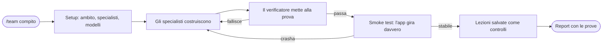

<div align="center">

[English](README.md) · [Italiano](README.it.md)

# 🧭 team-workflow

### Il tuo assistente AI per il codice, trasformato in un team che controlla il proprio lavoro.

Scrivi `/team <compito>`. Un agente capo sceglie gli specialisti giusti, loro costruiscono e si mettono alla prova a vicenda,<br>
e niente viene dichiarato "fatto" finché l'app non è stata davvero avviata.

[](https://github.com/antoStr/team-workflow/releases)
[](https://github.com/antoStr/team-workflow/actions/workflows/tests.yml)
[](LICENSE)
[](https://github.com/antoStr/team-workflow/stargazers)
[](https://antostr.github.io/team-workflow/it/)
<br>

-supported-4285f4)


**[Installa in 30 secondi](#-installa-in-30-secondi)** · **[Guardalo lavorare](#-guardalo-lavorare)** · **[Perché non finge](#-perché-non-finge)** · **[FAQ](#-faq)**

</div>

---

## 🤔 Il problema

Un assistente AI lavora da solo. Scrive il codice, si approva da solo, dice *"Risolto!"* senza avviare
l'app e il giorno dopo ha dimenticato il tuo progetto.

## ✅ La soluzione

**team-workflow** dà all'assistente un team e regole che non può aggirare a parole:

| | Un assistente | Con team-workflow |
|---|---|---|
| 👥 **Chi lavora** | un generalista | gli specialisti giusti tra **137** (backend, frontend, tester, reviewer, pentester...) |
| 🎮 **"Funziona"** | un'affermazione | l'app viene **avviata e controllata** (processo, exit code, log) |
| ⚔️ **Review** | l'autore si approva da solo | serve la firma di un verificatore indipendente |
| 🧠 **Memoria** | riparte da zero a ogni sessione | memoria di progetto e **brain graph** compatibile con Obsidian |
| 🛡️ **Errori** | ripetuti | registrati una volta, poi **bloccati da un controllo** a ogni modifica |
| 💰 **Costi** | una sorpresa | stima prima di iniziare, modelli economici per il lavoro di routine, report dei consumi |

---

## 🚀 Installa in 30 secondi

**Ti serve:** `git`, **Python 3** e una delle app supportate.

```bash
claude plugin marketplace add antoStr/team-workflow
claude plugin install team@team
```

Riavvia Claude Code e scrivi `/team <quello che vuoi>`. Fine.

<details>
<summary><b>agy (Antigravity)</b></summary>

```bash
agy plugin install https://github.com/antoStr/team-workflow
python ~/.gemini/config/plugins/team-workflow/skills/team/scripts/tw.py install-cli
```

Riavvia agy.
</details>

<details>
<summary><b>OpenCode</b> (CLI o app desktop)</summary>

```bash
git clone https://github.com/antoStr/team-workflow
python team-workflow/skills/team/scripts/install_opencode.py
```

Riavvia OpenCode. Comandi: `/team` oppure `/team-workflow/<nome>`.
</details>

<details>
<summary><b>Codex / opencodex</b></summary>

```bash
git clone https://github.com/antoStr/team-workflow
python team-workflow/skills/team/scripts/tw.py install-codex
```

Riavvia Codex. Comandi: `$team` oppure `$team-workflow-<nome>`.
</details>

---

## 🎬 Guardalo lavorare

Una sessione d'esempio (accorciata):

```text
tu     /team il gioco va in crash sul boss del livello 3

team   setup    poche domande rapide: ambito, quali specialisti, quali modelli
       piano    backend-dev corregge, tester verifica, code-reviewer rivede
       talk     #1 backend-dev → tester   [fix]       sprite del boss nullo dopo il reload
                #2 tester → backend-dev   [challenge] crasha ancora al secondo tentativo
                #3 backend-dev → tester   [fix]       sprite ricaricato a ogni tentativo
                #4 tester                 [verdict]   12 test passano, il gioco parte e arriva al livello 3
       smoke    tw.py smoke "npm run start" → processo vivo dopo 10 s, nessun errore
       learn    "ricarica gli asset a ogni tentativo" salvato come controllo per la prossima volta
       report   cosa è cambiato, le prove, e cosa aspetta ancora il tuo OK
```

**Un solo comando per tutto:**

| Vuoi... | Scrivi |
|---|---|
| Creare una funzione | `/team aggiungi il login OAuth2` |
| Correggere un bug | `/team il totale del carrello va in negativo con il coupon SAVE5` |
| Fare un audit di sicurezza | `/team audit degli endpoint API` |
| Rivedere le tue modifiche | `/team:review-changes` |
| Chiamare specialisti precisi | `/team:call-team tester e security-reviewer: controllate l'upload` |
| Controllare l'installazione | `/team doctor` |
| Aggiornare il plugin (zero token) | `/team upgrade` |

Il team risponde nella tua lingua. Codice, commit e documentazione del repository restano nella lingua del progetto.

---

## 🔍 Perché non finge

La maggior parte degli strumenti AI si affida a istruzioni che il modello può saltare. team-workflow mette
le regole importanti in **codice che gira da solo**:

1. **Zero Fake-Solved.** Un bug non è risolto finché `tw.py smoke "<comando di avvio>"` non avvia l'app vera
   e questa resta in piedi (exit code, stderr, qualche secondo di esecuzione). Su Windows, `--wsl` la avvia in Linux.
2. **Niente auto-approvazione.** Gli agenti lavorano su un canale condiviso (`tw.py talk`). Con il gate avversario
   (`tw.py gate`) l'autore non può approvare il proprio lavoro: deve farlo un verificatore.
3. **Gli errori diventano controlli.** Una lezione si salva con `tw.py learn record`. Se una regex può trovare
   l'errore, aggiungi `--check-pattern`. Da lì in poi un hook blocca quell'errore **a ogni modifica**, a fine sessione
   e in CI (`tw.py learn check`). Le lezioni senza controllo arrivano agli agenti come promemoria.
4. **Il setup non si salta per sbaglio.** In Claude Code un hook ferma gli agenti del team finché non hai risposto
   alle domande del setup. La prima domanda, **Mode**, offre **Auto** (l'orchestratore sceglie ruoli, skill,
   modelli ed effort per il compito) e **Skip setup**.
5. **Chiede prima di qualsiasi cosa irreversibile.** Le modifiche fuori dal compito finiscono nel report finale e
   aspettano il tuo consenso.

> [!NOTE]
> La regola 3 segue la lezione di *"All Code Is Slop (Except Mine)"* (Lauren Tan, AI Engineer 2026): ogni correzione
> deve diventare un controllo deterministico, non un'altra riga di istruzioni.

---

## 🧩 Cosa c'è dentro

<details>
<summary><b>👥 137 agenti specialisti</b></summary>

- **20 ruoli base**: `architect`, `backend-dev`, `frontend-dev`, `tester`, `code-reviewer`, `security-reviewer`,
  `database-engineer`, `devops-engineer`, `performance-engineer`, `ui-ux-designer`, `product-manager`, `doc-keeper`,
  `e2e-tester`, `data-analyst`, `market-researcher`, `marketing-strategist`, `refactor-specialist`,
  `release-manager`, `technical-writer`, `accessibility-specialist`.
- **Pack di linguaggi (26 ruoli)**: Python, TypeScript, Go, Rust, Java, C++, C#, Kotlin, Swift, PHP, Ruby, Dart/Flutter, F#.
- **Qualità, sicurezza e reversing**: `pentester`, `reverse-engineer`, `malware-analyst`, `silent-failure-hunter`, `type-design-reviewer` e altri.
- **Project management (`pm`)**: `project-manager`, `project-scheduler`, `project-controller`, `risk-manager`, `stakeholder-manager`, `agile-coach`.
- **Seconde opinioni (`alt-`)**: versioni alternative di ruoli esistenti.

L'agente capo sceglie solo gli specialisti che servono al compito. I compiti piccoli li fa da solo.
Elenco completo: **[catalogo](docs/CATALOG.it.md)**.
</details>

<details>
<summary><b>📚 533 voci di libreria</b> (417 skill, 94 comandi, 22 set di regole)</summary>

Pattern agentici e valutazione, TDD, migrazioni di database reversibili, refactoring sicuro, risparmio di token
(Caveman, Ponytail, Context Mode), componenti frontend (shadcn/ui, Radix, Magic UI...), project management.
Cerca con `tw.py library search <parole>`, attiva con `/team:library enable <voce o pack>`.
</details>

<details>
<summary><b>🛡️ Sicurezza, reversing e analisi malware</b></summary>

- **Pentesting Strix (42 playbook)**: OWASP Top 10, IDOR, SSRF, injection, race condition, JWT, prompt injection.
  Il `pentester` deve riprodurre ogni problema con un proof of concept.
- **Audit di sicurezza Cloudflare (15 playbook)**: memory safety, protocolli web e autenticazione, API, deploy cloud.
- **Reverse engineering**: IDA Pro, Ghidra, x64dbg, Cutter e server MCP di decompilazione.
- **Analisi malware (43 playbook)**: triage, unpacking, memory forensics, analisi C2, YARA, Sigma, STIX 2.1,
  analisi di URL e phishing.
</details>

<details>
<summary><b>🧠 Una memoria che dura mesi</b></summary>

- `docs/memory/`: stato del progetto, mappa, decisioni e playbook, controllati da `memcheck`.
- `docs/brain/`: un grafo compatibile con Obsidian di moduli, decisioni e lezioni, con wikilink.
  `tw.py brain query <modulo>` dà a un agente il modulo e i suoi vicini invece di un grep di tutto il repo.
- `tw.py brain rollover` compatta la storia vecchia in diari settimanali, così i progetti lunghi non riempiono il contesto.
</details>

<details>
<summary><b>📊 Project management</b></summary>

Il pack `pm` pianifica e controlla i progetti (ISO 21502, pratiche IPMA/PMI e agile): charter, cronoprogramma con
percorso critico, budget ed earned value, rischi, stakeholder. I numeri arrivano da calcolatori testati
(`cpm.py`, `evm.py`), non dal modello.

```text
/team:agents enable pm
/team:library enable project-management
/team pianifica il trasloco dell'ufficio: charter, WBS, cronoprogramma con percorso critico, budget e rischi
```
</details>

<details>
<summary><b>🔌 Add-on e server MCP</b></summary>

```bash
tw.py addons add popular       # Superpowers, skill Anthropic, ui-ux, context7
tw.py addons add mcp           # Playwright (browser vero), Context7, Serena
tw.py addons add token-saving  # Caveman, Ponytail, Context-mode
```
</details>

<details>
<summary><b>💰 Costi</b></summary>

- Il setup mostra una stima prima che partano gli agenti.
- Il lavoro di routine va ai modelli leggeri (`haiku`, `flash`), architettura e sicurezza ai più forti.
- `tw.py usage` (o `/team:usage-costs`) divide la spesa per ruolo, modello e sessione.
- `/team upgrade` aggiorna il plugin con uno script locale: zero token.
</details>

---

## ⚙️ Come funziona



---

## ❓ FAQ

<details>
<summary><b>Devo usare tutti i 137 agenti?</b></summary>

No. L'agente capo sceglie solo gli specialisti che servono e lavora da solo sui compiti piccoli.
</details>

<details>
<summary><b>Come impedisce agli agenti di dichiarare risolto ciò che non lo è?</b></summary>

La correzione è accettata solo dopo che `tw.py smoke` ha avviato il comando vero e il processo è rimasto sano,
e dopo la firma di un verificatore indipendente.
</details>

<details>
<summary><b>Posso saltare il setup della sessione?</b></summary>

Sì. Rispondi alla prima domanda, **Mode**, con **Skip setup** (le impostazioni attuali) o **Auto** (l'orchestratore
sceglie ruoli, skill, modelli ed effort per il compito). Funziona anche scrivere "skip setup" nella richiesta, o
rispondere solo "defaults".
`TEAM_WORKFLOW_SETUP_GATE=0` o `session_wizard=false` disattivano il gate del setup.
</details>

<details>
<summary><b>Può modificare file senza chiedere?</b></summary>

No. Tocca solo i file del tuo compito. Tutto il resto viene proposto nel report finale e aspetta il tuo OK.
</details>

<details>
<summary><b>Funziona su progetti lunghi?</b></summary>

Sì. La memoria e il brain graph conservano lo stato del progetto tra le sessioni, e `tw.py brain rollover`
archivia la storia vecchia in diari settimanali.
</details>

---

## 📖 Per saperne di più

- 📋 [Catalogo completo: 137 agenti, 533 voci di libreria](docs/CATALOG.it.md)
- 👥 [Guida agli agenti: usare, cambiare o crearne di nuovi](docs/AGENTS.it.md)
- 📘 [Manuale di riferimento: ogni comando e impostazione](docs/REFERENCE.it.md)
- 💬 [Come parlano tra loro gli agenti](skills/team/TALK.md)
- 🧠 [Struttura del brain graph](docs/brain/INDEX.md)
- 📜 [Note di rilascio](https://github.com/antoStr/team-workflow/releases)
- 🇬🇧 In inglese: [README](README.md) · [catalog](docs/CATALOG.md) · [agent guide](docs/AGENTS.md) · [manual](docs/REFERENCE.md)

---

<div align="center">

**Se team-workflow ti ha evitato un "risolto!" che non era risolto, ⭐ metti una stella al repo così lo trovano anche altri.**

Licenza MIT ([LICENSE](LICENSE)). Le risorse di terze parti importate mantengono le loro licenze ([NOTICE](skills/team/library/NOTICE.md)).

<sub><b>team-workflow v2.5.4</b></sub>

</div>
