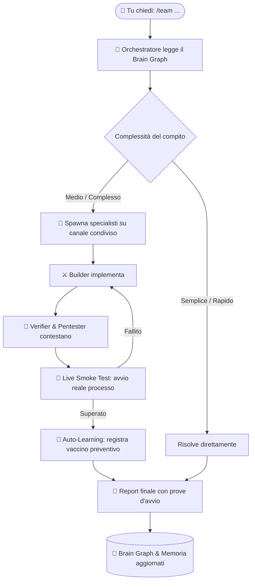

<div align="center">

[English](README.en.md) | [Italiano](README.md)

# 🧭 team-workflow

**Un team autonomo di agenti esperti dentro il tuo assistente di programmazione.**<br>
Memoria Brain Graph persistente · Verifica reale runtime "Zero Fake-Solved" · Auto-learning & Vaccini preventivi · Team avversario con canale condiviso · Report trasparente a fine lavoro.

[](https://github.com/antoStr/team-workflow/releases)
[](https://github.com/antoStr/team-workflow/actions/workflows/tests.yml)
[](LICENSE)

-supportato-4285f4)


</div>

---

## 📑 Indice

1. [Cos'è, in due parole](#-cosè-in-due-parole)
2. [Perché usarlo](#-perché-usarlo)
3. [Le novità di v2.0](#-le-novità-di-v20)
4. [Come funziona](#️-come-funziona)
5. [Installazione](#-installazione)
6. [Il comando universale `/team` e i primi 5 minuti](#-il-comando-universale-team-e-i-primi-5-minuti)
7. [Zero Fake-Solved: Live Smoke Test](#-zero-fake-solved-live-smoke-test)
8. [Auto-Learning & Vaccini Preventivi](#-auto-learning--vaccini-preventivi)
9. [Memoria di Progetto & Brain Graph](#-memoria-di-progetto--brain-graph)
10. [Gli agenti](#-gli-agenti)
11. [Agenti che parlano tra loro & Gate Avversario](#-agenti-che-parlano-tra-loro--gate-avversario)
12. [La libreria di skill](#-la-libreria-di-skill)
13. [Cybersecurity & Reverse Engineering](#-cybersecurity--reverse-engineering)
14. [Add-on e server MCP](#-add-on-e-server-mcp)
15. [Aggiornamenti a Zero Token](#-aggiornamenti-a-zero-token)
16. [Costi e consumi](#-costi-e-consumi)
17. [Domande frequenti](#-domande-frequenti)
18. [Per saperne di più](#-per-saperne-di-più)
19. [Licenza](#-licenza)

---

## 💡 Cos'è, in due parole

**team-workflow** è un plugin universale per **Claude Code**, **agy (Antigravity)**, **OpenCode** e **Codex** (incluso **opencodex**).

Di solito parli con un unico modello generalista che fa tutto da solo, spesso sostiene di aver risolto i problemi senza aver mai avviato l'applicazione e dimentica il contesto tra una sessione e l'altra.

Con **team-workflow**, l'assistente diventa il **responsabile tecnico di un team**:
- Comprende l'obiettivo e seleziona gli **specialisti dedicati** (frontend, backend, pentester, reverse engineer, tester, reviewer, architect...).
- Mantiene la memoria di progetto con un **Brain Knowledge Graph** compatibile con Obsidian.
- **Verifica realmente a runtime** che l'applicazione o il gioco compili, si avvii e resti stabile senza crash (**Zero Fake-Solved**).
- **Impara automaticamente** dagli errori del team e inietta **vaccini anti-pattern** nelle sessioni future.
- Ti consegna un **report chiaro** con prove oggettive e ti chiede il permesso prima di qualsiasi modifica irreversibile.

> [!TIP]
> **Tutto in un solo comando**: ora basta usare `/team <il tuo compito>` per avviare il team completo senza dover memorizzare decine di comandi lunghi.

---

## ✨ Perché usarlo

| | Assistente Standard | Con team-workflow v2.0 |
|---|---|---|
| 🧠 **Memoria** | Ogni sessione riparte da zero | Knowledge Graph in `docs/brain/` persistente e compattazione settimanale |
| 👥 **Competenze** | Un solo modello generalista | **130 specialisti**: core, linguaggi, framework, sicurezza offensiva, reversing e malware analysis |
| 🎮 **Verifica Reale** | "Ho corretto il codice!" (senza avviare) | **Zero Fake-Solved**: smoke test runtime su processo reale, log e stabilità d'avvio |
| 🛡️ **Auto-Apprendimento** | Ripete gli stessi bug col tempo | Registra anti-pattern e inietta **vaccini comportamentali** ad ogni prompt |
| ⚔️ **Controllo Qualità** | Chi scrive approva se stesso | Gate avversario: costruttore contro verificatore su canale condiviso |
| ⚡ **Semplicità d'Uso** | 25 comandi diversi da ricordare | **Comando universale `/team`** per qualsiasi operazione |
| 🔄 **Aggiornamenti** | Manuali o con consumo token | `/team upgrade` a **zero token** tramite script nativo locale |
| 💰 **Costi & Budget** | Consumi opachi e imprevisti | Stima prima del task, split costi per modello/agente, dashboard integrata |

---

## 🚀 Le novità di v2.0

- 🎯 **Comando Universale `/team`**: basta `/team aggiungi login`, `/team correggi crash del menu` o `/team audit sicurezza`. Tutti i vecchi comandi lunghi restano supportati come alias retrocompatibili.
- 🚦 **Zero Fake-Solved Gate**: fine delle allucinazioni in cui l'AI dice "Risolto!" ma il gioco o l'app non parte nemmeno. Il motore lancia `tw.py smoke "<cmd>"` con timeout di sicurezza e valida l'avvio reale.
- 💉 **Continuous Auto-Learning & Vaccini**: ogni volta che un bug viene corretto o un gate avversario supera una contestazione, `tw.py learn` registra l'anti-pattern e lo inietta come vaccino nelle istruzioni del team.
- 🧠 **Brain Knowledge Graph**: archivio in `docs/brain/` con nodi Markdown, frontmatter YAML, wikilink bidirezionali e supporto ai grafi Obsidian, con `tw.py brain rollover` per compattazione settimanale automatica.
- 🛡️ **Cybersecurity Suite (Strix, Cloudflare & Malware Intel)**: 100 playbook avanzati di sicurezza offensiva, difensiva e analisi malware (42 Strix + 15 Cloudflare + 43 Malware Analysis & URL Threat Hunting) per un totale di **512 voci di libreria**.
- 🔬 **Ruoli Pentester, Reverse Engineer & Malware Analyst**: audit di binari compilati, firmware, API e triage di sample malware con supporto a IDA Pro, Ghidra, x64dbg, Cutter, YARA, Sigma e URLScan.io.
- 💸 **Zero-Token Self-Update**: notifica automatica di nuovi rilasci all'avvio sessione e aggiornamento immediato con `/team upgrade`.

---

## ⚙️ Come funziona



---

## 📦 Installazione

**Requisiti:** `git`, **Python 3** e una delle quattro app supportate.

<details open>
<summary><b>Claude Code</b> (consigliato)</summary>

```bash
claude plugin marketplace add antoStr/team-workflow
claude plugin install team-workflow@team-workflow
```

Riavvia Claude Code. Fatto!

</details>

<details>
<summary><b>agy (Antigravity)</b></summary>

```bash
agy plugin install https://github.com/antoStr/team-workflow
python ~/.gemini/config/plugins/team-workflow/skills/team-workflow/scripts/tw.py install-cli
```

Riavvia agy. Fatto!

</details>

<details>
<summary><b>OpenCode</b> (CLI o app desktop)</summary>

```bash
git clone https://github.com/antoStr/team-workflow
python team-workflow/skills/team-workflow/scripts/install_opencode.py
```

Riavvia OpenCode. I comandi sono disponibili come `/team` o `/team-workflow/<nome>`.

</details>

<details>
<summary><b>Codex / opencodex</b></summary>

```bash
git clone https://github.com/antoStr/team-workflow
python team-workflow/skills/team-workflow/scripts/tw.py install-codex
```

Riavvia Codex. I comandi sono registrati come `$team` o `$team-workflow-<nome>`.

</details>

---

## ⚡ Il comando universale `/team` e i primi 5 minuti

Non c'è più bisogno di ricordare decine di comandi. Usa semplicemente `/team`:

| Cosa vuoi fare | Comando | Cosa fa |
|---|---|---|
| **Avviare un task** | `/team crea autenticazione OAuth` | Wizard automatico, team di specialisti, implementazione e test |
| **Risolvere un bug reale** | `/team il gioco va in crash al livello 3` | Riproduzione, fix, live smoke test reale e verifica che non crashi |
| **Audit di sicurezza** | `/team controlla vulnerabilità e binari` | Pentester e security reviewer analizzano API, codice e dipendenze |
| **Aggiornare il plugin** | `/team upgrade` | Scarica e aggiorna l'ultima versione a **zero token** |
| **Leggere la memoria** | `/team status` o `/team memory` | Mostra stato, grafi della conoscenza e vaccini attivi |

I comandi dettagliati e le utility a costo zero token sono integrati in `/team`:
- `/team start [compito]` (o `/team fix-bug <bug>`)
- `/team doctor` (healthcheck del plugin, harness e ruoli con auto-fix: `doctor --fix`)
- `/team audit` (audit di sicurezza e conformità configurazioni)
- `/team review-changes` (revisione approfondita del diff)
- `/team call-team <ruoli>` (convocazione manuale di specifici specialisti)
- `/team release [versione]` (gestione versionamento e rilascio)
- `agy plugin update team-workflow` (aggiornamento trasparente da terminale Windows, macOS e Linux)

---

## 🚦 Zero Fake-Solved: Live Smoke Test

Uno dei problemi più frustranti nello sviluppo con LLM è l'agente che dichiara: *"Problema risolto con successo!"*, ma poi l'applicazione non compila, fallisce all'avvio o crasha silenziosamente.

team-workflow integra il motore **Live Smoke Test**:
```bash
python tw.py smoke "<comando di avvio>" --timeout 5 [--strict]
```

- Lancia il vero processo del gioco o dell'applicazione in un sandbox controllato.
- Monitora l'avvio, il codice di uscita, gli errori su `stderr` e la stabilità dopo 5 o 10 secondi di esecuzione.
- **Regola Zero Fake-Solved**: l'orchestratore ha il divieto tassativo di dichiarare un task completato finché lo smoke test non produce evidenza tangibile di corretta esecuzione.
- **WSL Bridge nativo**: su sistemi Windows, aggiungi il flag `--wsl` (`tw.py smoke "<cmd>" --wsl`) per eseguire smoke test e verifiche dentro l'ambiente Linux WSL2 reale (ad esempio per daemon di rete, ELF binari o test su `/proc`).

---

## 💉 Auto-Learning & Vaccini Preventivi

Ad ogni sessione, gli agenti diventano più intelligenti:

1. **Rilevamento**: quando un bug viene risolto o un test avversario intercetta un errore sottile, il team estrae l'anti-pattern.
2. **Registrazione**: `tw.py learn record --pattern "..." --fix "..." --reason "..."` crea un nodo in `docs/brain/learnings/`.
3. **Vaccinazione**: a ogni nuovo avvio (`session_start.py`), i vaccini pertinenti vengono iniettati nel contesto iniziale degli agenti, impedendo la regressione su errori già affrontati.

---

## 🧠 Memoria di Progetto & Brain Graph

Il sistema di memoria supporta sia la modalità classica (`docs/memory/`) sia il nuovo **Brain Graph** (`docs/brain/`), compatibile nativamente con Obsidian:

- **Nodi strutturati**: architettura, moduli, decisioni (ADR), convenzioni, log settimanali e vaccini.
- **Wikilink bidirezionali**: navigazione immediata delle dipendenze ad 1-hop senza dover scansionare l'intera codebase con grep.
- **Compattazione automatica**: `tw.py brain rollover` archivia lo stato delle settimane precedenti in journal di riepilogo (`docs/brain/journal/week-YYYY-WXX.md`), consentendo di lavorare per mesi senza saturare la finestra di contesto.
- **Verifica di coerenza**: `tw.py brain check --strict` valida link orfani o nodi rotti.

---

## 👥 Gli agenti

team-workflow include **130 specialisti**:
- **20 nel core**: `architect`, `backend-dev`, `frontend-dev`, `tester`, `code-reviewer`, `security-reviewer`, `database-engineer`, `devops-engineer`, `performance-engineer`, `ui-ux-designer`, `product-manager`, `doc-keeper`, `e2e-tester`, `data-analyst`, `market-researcher`, `marketing-strategist`, `refactor-specialist`, `release-manager`, `technical-writer`, `accessibility-specialist`.
- **Pack linguaggi (26 agenti)**: Python, TypeScript, Go, Rust, Java, C++, C#, Kotlin, Swift, PHP, Ruby, Dart/Flutter, F#.
- **Pack qualità, sicurezza & reversing**: `pentester`, `reverse-engineer`, `malware-analyst`, `silent-failure-hunter`, `type-design-reviewer`, e molti altri.
- **Pack alternativi (`alt-`)**: versioni per una seconda opinione indipendente.

📋 Consulta il **[Catalogo Completo](docs/CATALOG.md)** per le schede di tutti i 130 ruoli.

---

## 💬 Agenti che parlano tra loro & Gate Avversario

Per i compiti complessi, gli agenti comunicano su un canale condiviso (`tw.py talk`):

```text
#1 backend-dev → tester     [finding]   Corretto il calcolo del carrello in cart.py
#2 tester → backend-dev     [challenge] Test fallito: con coupon SAVE5 il totale diventa negativo (-3.00 €)
#3 backend-dev → tester     [fix]       Aggiunto vincolo min_total = 0.00 €
#4 tester                   [verdict]   Verificato e approvato: 12 test su 12 passano
```

Grazie al **Gate Avversario** (`tw.py gate`), il builder non può mai approvare il proprio codice: un verificatore indipendente deve validare la modifica prima che venga accettata.

---

## 📚 La libreria di skill

La libreria integrata comprende **512 voci** (396 skill, 94 comandi, 22 set di regole):
- Ingegneria agentica, cicli autonomi e harness di valutazione.
- Ottimizzazione token e caching (Caveman, Ponytail, Context Mode).
- Testing TDD, migrazioni reversibili, refactoring sicuro.
- Ricerca istantanea con `tw.py library search <parole>`.

---

## 🛡️ Cybersecurity, Reversing & Malware Intel

La suite di sicurezza include quattro grandi pack specializzati:

1. **Strix Autonomous Pentesting** (42 playbooks):
   - OWASP Top 10, IDOR, SSRF, SQL Injection, NoSQL Injection, Race Conditions, Prototype Pollution, JWT broken authentication, LLM Prompt Injection e Agentic Security.
   - Ruolo `pentester`: richiede sempre PoC funzionante, controprove e calibrazione CVSS prima di dichiarare un rischio.

2. **Cloudflare Security Audit** (15 playbooks):
   - Memory safety per codice compilato (C/C++, Rust, Go), Web protocol & auth, client-side, API/RPC messaging, cloud deployment e data lifecycle.

3. **Reverse Engineering & Decompilazione**:
   - Ruolo `reverse-engineer`: supporto per **IDA Pro**, **Ghidra**, **x64dbg**, **Cutter** e server MCP di decompilazione. Analisi di binari ELF/PE, ricostruzione strutture dati, firma delle funzioni e verifica di buffer overflow.

4. **Malware Analysis & Threat Intel URL/Richieste** (43 playbooks):
   - Ruolo `malware-analyst`: triage PE/ELF, unpacking, memory forensics, dissezione protocolli C2, YARA, Sigma, STIX 2.1.
   - Audit link e richieste: scansione URLScan.io, ispezione header phishing, domain fronting hunting, tracking infrastrutture avversarie e analisi traffico di rete (Zeek, TShark).

---

## 🔌 Add-on e server MCP

Installa strumenti e capacità aggiuntive in tutte le app supportate con un solo comando:

```bash
tw.py addons add popular       # Superpowers, skill Anthropic, ui-ux, context7
tw.py addons add mcp           # Playwright (browser reale), Context7, Serena
tw.py addons add token-saving  # Caveman, Ponytail, Context-mode
```

---

## 🔄 Aggiornamenti a Zero Token

Non consumare token preziosi per aggiornare il plugin:

- **Notifica automatica**: all'apertura di una sessione, un controllo locale non invasivo ti segnala se è disponibile una nuova versione.
- **Aggiornamento istantaneo**: digita `/team upgrade` (o da terminale `tw.py upgrade`). Lo script esegue il pull locale da git, riallinea i file e rigenera i cataloghi senza effettuare chiamate LLM.

---

## 💰 Costi e consumi

- **Stima preventiva**: il wizard calcola il costo previsto in base ai token e ai modelli assegnati a ciascun ruolo.
- **Ottimizzazione intelligente**: i ruoli secondari possono usare modelli rapidi ed economici (`haiku`, `flash`), riservando i modelli di punta (`sonnet`, `opus`, `pro`) ai compiti critici di architettura e sicurezza.
- **Trasparenza**: il comando `tw.py usage` (o `/team-workflow:usage-costs`) mostra i consumi esatti divisi per agente, modello e sessione.

---

## ❓ Domande frequenti

<details>
<summary><b>Devo usare tutti i 130 agenti?</b></summary>

No! L'orchestratore sceglie solo 1 o 2 agenti strettamente necessari per il tuo compito specifico. Per compiti piccoli, l'assistente lavora da solo.
</details>

<details>
<summary><b>Come evito che l'agente dica di aver risolto senza testare?</b></summary>

È integrato il sistema Zero Fake-Solved: l'agente ha la regola vincolante di eseguire `tw.py smoke "<comando>"` per verificare l'avvio reale del processo prima di considerare concluso il compito.
</details>

<details>
<summary><b>Come fa a gestire sessioni lunghe settimane o mesi?</b></summary>

Grazie al motore Brain Graph (`docs/brain/`): le sessioni passate vengono riassunte in journal settimanali tramite `tw.py brain rollover`, mantenendo snello il contesto attivo senza perdere la memoria storica del progetto.
</details>

<details>
<summary><b>Il plugin può modificare file non richiesti?</b></summary>

No. Modifica solo i file inerenti al compito assegnato. Tutte le altre proposte vengono inserite nel report finale e richiedono la tua autorizzazione esplicita.
</details>

---

## 📖 Per saperne di più

- 📋 [Catalogo Completo (130 agenti, 512 skill)](docs/CATALOG.md)
- 👥 [Guida agli agenti e creazione ruoli](docs/AGENTS.md)
- 📘 [Manuale di riferimento comandi e configurazione](docs/REFERENCE.md)
- 💬 [Team Talk e protocollo di conversazione](skills/team-workflow/TALK.md)
- 🧠 [Brain Knowledge Graph & Struttura nodi](docs/brain/INDEX.md)
- 📜 [Note di rilascio](https://github.com/antoStr/team-workflow/releases)

---

## 📄 Licenza

Distribuito con licenza **MIT** (vedi [LICENSE](LICENSE)). I contenuti di terze parti importati nella libreria e nei ruoli mantengono le rispettive licenze d'origine ([NOTICE](skills/team-workflow/library/NOTICE.md)).

<div align="center">
<sub>Sviluppato con dedizione per programmatori e team aumentati da AI · <b>team-workflow v2.1.1</b></sub>
</div>
