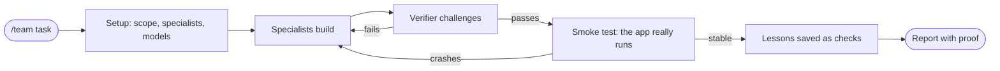

<div align="center">

[English](README.md) · [Italiano](README.it.md)

# 🧭 team-workflow

### Your AI coding assistant, turned into a team that checks its own work.

Type `/team <task>`. A lead agent picks the right specialists, they build and challenge each other,<br>
and nothing is called "done" until the app has actually run.

[](https://github.com/antoStr/team-workflow/releases)
[](https://github.com/antoStr/team-workflow/actions/workflows/tests.yml)
[](LICENSE)
[](https://github.com/antoStr/team-workflow/stargazers)
[](https://antostr.github.io/team-workflow/)
<br>

-supported-4285f4)


**[Install in 30 seconds](#-install-in-30-seconds)** · **[See it work](#-see-it-work)** · **[Why it does not fake it](#-why-it-does-not-fake-it)** · **[FAQ](#-faq)**

</div>

---

## 🤔 The problem

A single AI assistant works alone. It writes the code, approves its own code, says *"Fixed!"* without
starting the app, and forgets your project the next day.

## ✅ The fix

**team-workflow** gives the assistant a team and a set of rules it cannot talk its way around:

| | One assistant | With team-workflow |
|---|---|---|
| 👥 **Who works** | one generalist | the right specialists out of **137** (backend, frontend, tester, reviewer, pentester...) |
| 🎮 **"It works"** | a claim | the app is **started and checked** (process, exit code, logs) |
| ⚔️ **Review** | the author approves itself | an independent verifier must sign off |
| 🧠 **Memory** | starts from zero each session | project memory and an Obsidian-compatible **brain graph** |
| 🛡️ **Mistakes** | repeated | recorded once, then **enforced by a check** on every edit |
| 💰 **Cost** | a surprise | estimate up front, cheap models for routine work, usage report |

---

## 🚀 Install in 30 seconds

**You need:** `git`, **Python 3** and one of the supported apps.

```bash
claude plugin marketplace add antoStr/team-workflow
claude plugin install team@team
```

Restart Claude Code, then type `/team <what you want>`. That is all.

<details>
<summary><b>agy (Antigravity)</b></summary>

```bash
agy plugin install https://github.com/antoStr/team-workflow
python ~/.gemini/config/plugins/team-workflow/skills/team/scripts/tw.py install-cli
```

Restart agy.
</details>

<details>
<summary><b>OpenCode</b> (CLI or desktop app)</summary>

```bash
git clone https://github.com/antoStr/team-workflow
python team-workflow/skills/team/scripts/install_opencode.py
```

Restart OpenCode. Commands: `/team` or `/team-workflow/<name>`.
</details>

<details>
<summary><b>Codex / opencodex</b></summary>

```bash
git clone https://github.com/antoStr/team-workflow
python team-workflow/skills/team/scripts/tw.py install-codex
```

Restart Codex. Commands: `$team` or `$team-workflow-<name>`.
</details>

---

## 🎬 See it work

An example session (shortened):

```text
you    /team the game crashes on the stage 3 boss

team   setup    a few quick questions: scope, which specialists, which models
       plan     backend-dev fixes, tester verifies, code-reviewer reviews
       talk     #1 backend-dev → tester   [fix]       null boss sprite after reload
                #2 tester → backend-dev   [challenge] still crashes on a second retry
                #3 backend-dev → tester   [fix]       sprite reloaded on every retry
                #4 tester                 [verdict]   12 tests pass, game boots and runs stage 3
       smoke    tw.py smoke "npm run start" → process alive after 10 s, no errors
       learn    "reload assets on retry" saved as a check for the next time
       report   what changed, the proof, and anything that still needs your OK
```

**One command for everything:**

| You want to... | Type |
|---|---|
| Build a feature | `/team add OAuth2 login` |
| Fix a bug | `/team the cart total goes negative with coupon SAVE5` |
| Audit security | `/team audit the API endpoints` |
| Review your changes | `/team:review-changes` |
| Call specific specialists | `/team:call-team tester and security-reviewer: check the upload` |
| Check the installation | `/team doctor` |
| Update the plugin (no tokens used) | `/team upgrade` |

The team answers in your language. Code, commits and repository docs keep the project's language.

---

## 🔍 Why it does not fake it

Most AI tools rely on instructions the model can skip. team-workflow puts the important rules in
**code that runs on its own**:

1. **Zero Fake-Solved.** A bug is not fixed until `tw.py smoke "<launch command>"` starts the real app
   and it stays up (exit code, stderr, a few seconds of runtime). On Windows, `--wsl` runs it in Linux.
2. **No self-approval.** Agents work on a shared channel (`tw.py talk`). Under the adversarial gate
   (`tw.py gate`) the author cannot approve its own work: a verifier has to.
3. **Mistakes become checks.** A lesson is saved with `tw.py learn record`. If a regex can find the mistake,
   add `--check-pattern`. From then on a hook blocks the mistake on **every edit**, at the end of the
   session and in CI (`tw.py learn check`). Lessons without a check are passed to the agents as reminders.
4. **The setup cannot be skipped by accident.** In Claude Code a hook holds the team agents until the setup
   questions are answered. The first question, **Mode**, offers **Auto** (the orchestrator picks roles, skills,
   models and efforts for the task) and **Skip setup**.
5. **It asks before anything irreversible.** Changes outside the task are listed in the final report and
   wait for your consent.

> [!NOTE]
> Rule 3 follows the lesson of *"All Code Is Slop (Except Mine)"* (Lauren Tan, AI Engineer 2026): every correction
> should become a deterministic check, not one more line of instructions.

---

## 🧩 What is inside

<details>
<summary><b>👥 137 specialist agents</b></summary>

- **20 core roles**: `architect`, `backend-dev`, `frontend-dev`, `tester`, `code-reviewer`, `security-reviewer`,
  `database-engineer`, `devops-engineer`, `performance-engineer`, `ui-ux-designer`, `product-manager`, `doc-keeper`,
  `e2e-tester`, `data-analyst`, `market-researcher`, `marketing-strategist`, `refactor-specialist`,
  `release-manager`, `technical-writer`, `accessibility-specialist`.
- **Language packs (26 roles)**: Python, TypeScript, Go, Rust, Java, C++, C#, Kotlin, Swift, PHP, Ruby, Dart/Flutter, F#.
- **Quality, security and reversing**: `pentester`, `reverse-engineer`, `malware-analyst`, `silent-failure-hunter`, `type-design-reviewer` and more.
- **Project management (`pm`)**: `project-manager`, `project-scheduler`, `project-controller`, `risk-manager`, `stakeholder-manager`, `agile-coach`.
- **Second opinions (`alt-`)**: alternative versions of existing roles.

The lead agent picks only the specialists a task needs. Small tasks it does alone.
Full list: **[catalog](docs/CATALOG.md)**.
</details>

<details>
<summary><b>📚 533 library entries</b> (417 skills, 94 commands, 22 rule sets)</summary>

Agentic patterns and evaluation, TDD, reversible database migrations, safe refactoring, token saving
(Caveman, Ponytail, Context Mode), frontend components (shadcn/ui, Radix, Magic UI...), project management.
Search with `tw.py library search <words>`, switch on with `/team:library enable <entry or pack>`.
</details>

<details>
<summary><b>🛡️ Security, reversing and malware analysis</b></summary>

- **Strix pentesting (42 playbooks)**: OWASP Top 10, IDOR, SSRF, injection, race conditions, JWT, prompt injection.
  The `pentester` must reproduce every finding with a proof of concept.
- **Cloudflare security audit (15 playbooks)**: memory safety, web protocols and auth, APIs, cloud deployment.
- **Reverse engineering**: IDA Pro, Ghidra, x64dbg, Cutter and decompiler MCP servers.
- **Malware analysis (43 playbooks)**: triage, unpacking, memory forensics, C2 analysis, YARA, Sigma, STIX 2.1,
  URL and phishing analysis.
</details>

<details>
<summary><b>🧠 Memory that lasts for months</b></summary>

- `docs/memory/`: project state, map, decisions and playbooks, checked by `memcheck`.
- `docs/brain/`: an Obsidian-compatible graph of modules, decisions and lessons with wikilinks.
  `tw.py brain query <module>` gives an agent the module and its neighbours instead of a grep of the whole repo.
- `tw.py brain rollover` compacts old history into weekly journals, so long projects do not fill the context.
</details>

<details>
<summary><b>📊 Project management</b></summary>

The `pm` pack plans and controls projects (ISO 21502, IPMA/PMI and agile practice): charter, schedule with
critical path, budget and earned value, risks, stakeholders. The numbers come from tested calculators
(`cpm.py`, `evm.py`), not from the model.

```text
/team:agents enable pm
/team:library enable project-management
/team plan the office move: charter, WBS, schedule with critical path, budget and risks
```
</details>

<details>
<summary><b>🔌 Add-ons and MCP servers</b></summary>

```bash
tw.py addons add popular       # Superpowers, Anthropic skills, ui-ux, context7
tw.py addons add mcp           # Playwright (real browser), Context7, Serena
tw.py addons add token-saving  # Caveman, Ponytail, Context-mode
```
</details>

<details>
<summary><b>💰 Costs</b></summary>

- The setup shows an estimate before the agents start.
- Routine work goes to light models (`haiku`, `flash`), architecture and security to the strongest ones.
- `tw.py usage` (or `/team:usage-costs`) breaks spending down by role, model and session.
- `/team upgrade` updates the plugin with a local script: no tokens.
</details>

---

## ⚙️ How it works



---

## ❓ FAQ

<details>
<summary><b>Do I have to use all 137 agents?</b></summary>

No. The lead agent picks only the specialists the task needs, and works alone on small tasks.
</details>

<details>
<summary><b>How does it stop the agents from claiming a fix that does not work?</b></summary>

The fix is accepted only after `tw.py smoke` starts the real command and the process stays healthy, and after
an independent verifier signs off.
</details>

<details>
<summary><b>Can I skip the session setup?</b></summary>

Yes. Answer the first question, **Mode**, with **Skip setup** (your current settings) or **Auto** (the orchestrator
picks roles, skills, models and efforts for the task). Writing "skip setup" in the request, or answering just
"defaults", also works.
`TEAM_WORKFLOW_SETUP_GATE=0` or `session_wizard=false` turns the setup gate off.
</details>

<details>
<summary><b>Can it change files without asking?</b></summary>

No. It only touches files that belong to your task. Anything else is proposed in the final report and waits for your OK.
</details>

<details>
<summary><b>Does it work on long projects?</b></summary>

Yes. The memory and the brain graph keep the project's state across sessions, and `tw.py brain rollover`
archives old history into weekly journals.
</details>

---

## 📖 Learn more

- 📋 [Full catalog: 137 agents, 533 library entries](docs/CATALOG.md)
- 👥 [Agent guide: use, change or create agents](docs/AGENTS.md)
- 📘 [Reference manual: every command and setting](docs/REFERENCE.md)
- 💬 [How agents talk to each other](skills/team/TALK.md)
- 🧠 [Brain graph layout](docs/brain/INDEX.md)
- 📜 [Release notes](https://github.com/antoStr/team-workflow/releases)
- 🇮🇹 In Italian: [README](README.it.md) · [catalog](docs/CATALOG.it.md) · [agent guide](docs/AGENTS.it.md) · [manual](docs/REFERENCE.it.md)

---

<div align="center">

**If team-workflow saves you a "fixed!" that was not fixed, ⭐ star the repo so others find it.**

MIT License ([LICENSE](LICENSE)). Imported third-party resources keep their own licenses ([NOTICE](skills/team/library/NOTICE.md)).

<sub><b>team-workflow v2.5.4</b></sub>

</div>
