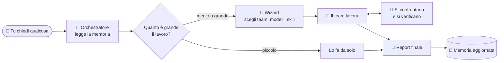

<div align="center">

# 🧭 team-workflow

**Un piccolo team di agenti esperti dentro il tuo assistente di programmazione.**<br>
Memoria di progetto condivisa · agenti che lavorano e si controllano a vicenda · report chiaro a fine lavoro.

[](https://github.com/antoStr/team-workflow/releases)
[](https://github.com/antoStr/team-workflow/actions/workflows/tests.yml)
[](LICENSE)

-supportato-4285f4)


</div>

---

## 📑 Indice

1. [Cos'è, in due parole](#-cosè-in-due-parole)
2. [Perché usarlo](#-perché-usarlo)
3. [Come funziona](#️-come-funziona)
4. [Installazione](#-installazione)
5. [I primi 5 minuti](#-i-primi-5-minuti)
6. [I comandi da conoscere](#️-i-comandi-da-conoscere)
7. [Gli agenti](#-gli-agenti)
8. [Agenti che parlano tra loro](#-agenti-che-parlano-tra-loro)
9. [La libreria di skill](#-la-libreria-di-skill)
10. [Add-on e server MCP](#-add-on-e-server-mcp)
11. [Le impostazioni principali](#️-le-impostazioni-principali)
12. [Costi e consumi](#-costi-e-consumi)
13. [Domande frequenti](#-domande-frequenti)
14. [Per saperne di più](#-per-saperne-di-più)
15. [Licenza](#-licenza)

---

## 💡 Cos'è, in due parole

**team-workflow** è un plugin per **Claude Code**, **agy (Antigravity)**, **OpenCode** e
**Codex** (anche quando passa da **opencodex**).

Di solito parli con un solo assistente che fa tutto da solo. Con team-workflow l'assistente
diventa il **capo di un team**: capisce il lavoro, ti propone gli specialisti giusti (chi
scrive il codice, chi lo testa, chi controlla la sicurezza...), li fa lavorare, li fa
confrontare tra loro e alla fine ti consegna un report con quello che è stato fatto e
verificato.

> [!TIP]
> Non devi imparare nulla di nuovo per iniziare: dopo l'installazione basta chiedere come
> sempre ("aggiungi il login", "correggi questo bug"). Il team entra in gioco quando serve.

---

## ✨ Perché usarlo

| | Senza team-workflow | Con team-workflow |
|---|---|---|
| 🧠 **Memoria** | Ogni sessione riparte da zero | Il progetto ha una memoria (`docs/memory`) letta a ogni avvio |
| 👥 **Competenze** | Un solo assistente generalista | 127 specialisti tra cui scegliere: sviluppo, test, sicurezza, design, dati... |
| 🔍 **Controlli** | Ti fidi di quello che dice | Gli agenti si contestano le affermazioni e verificano le correzioni con le prove |
| 🧾 **Risultato** | Un messaggio finale | Un report: fatto, verificato, rilievi, decisioni da prendere |
| 🛑 **Sicurezza** | Applica quello che crede | Ti chiede prima di applicare qualsiasi cosa tu non abbia chiesto |
| 💰 **Costi** | Non sai quanto spendi | Stima prima di partire e dashboard dei consumi dopo |

---

## ⚙️ Come funziona



1. **Chiedi** quello che ti serve, nella tua lingua.
2. **L'orchestratore** (l'assistente principale) legge la memoria del progetto e valuta il lavoro.
3. Se serve un team, il **wizard** ti mostra le opzioni: chi lavora, con quale modello e quanto
   impegno, quali skill usare. Scegli tu.
4. **Il team lavora**: chi costruisce e chi controlla sono sempre agenti diversi.
5. Gli agenti **parlano tra loro** su un canale condiviso: domande, obiezioni, correzioni, verdetti.
6. Ricevi il **report** e la **memoria** si aggiorna per la prossima volta.

---

## 📦 Installazione

**Ti servono:** `git`, **Python 3** e almeno una delle tre app.

<details open>
<summary><b>Claude Code</b> (consigliato)</summary>

```bash
claude plugin marketplace add antoStr/team-workflow
claude plugin install team-workflow@team-workflow
```

Riavvia Claude Code. Fatto.

</details>

<details>
<summary><b>agy (Antigravity)</b></summary>

```bash
agy plugin install https://github.com/antoStr/team-workflow
python3 ~/.gemini/config/plugins/team-workflow/skills/team-workflow/scripts/tw.py install-cli
```

Il secondo comando crea il comando `team-workflow` e aggiunge `agy plugin update`, che agy
non ha. Riavvia agy una volta.

</details>

<details>
<summary><b>OpenCode</b> (CLI o app desktop)</summary>

```bash
git clone https://github.com/antoStr/team-workflow
python3 team-workflow/skills/team-workflow/scripts/install_opencode.py
```

Riavvia OpenCode. I comandi si chiamano `/team-workflow/<nome>`.

</details>

<details>
<summary><b>Codex</b> (CLI o app, anche tramite opencodex)</summary>

```bash
git clone https://github.com/antoStr/team-workflow
python3 team-workflow/skills/team-workflow/scripts/tw.py install-codex
```

Riavvia Codex. I comandi sono skill che si chiamano `$team-workflow-<nome>`
(per esempio `$team-workflow-start`); gli agenti sono agenti di Codex. Con **opencodex** non
serve altro: è un proxy davanti a Codex e usa la stessa installazione.

</details>

> [!NOTE]
> **Su Windows** `python3` spesso apre il Microsoft Store invece di Python: usa `python` al suo
> posto. Per aggiornare in futuro: `/team-workflow:update-plugin` (in agy
> `!team-workflow update`).

---

## 🚀 I primi 5 minuti

Apri il tuo progetto nell'app e segui questi passi:

| Passo | Cosa scrivi | Cosa succede |
|:---:|---|---|
| **1** | `/team-workflow:setup` | Scegli se team-workflow parte da solo in ogni progetto o solo quando lo chiami, e il resto delle impostazioni. *Facoltativo:* i valori predefiniti vanno già bene. |
| **2** | `/team-workflow:setup-memory` | Crea la memoria del progetto in `docs/memory`, leggendo il codice. Poi controlla cosa ha scritto. |
| **3** | `/team-workflow:start` | Il wizard ti mostra le opzioni e ti chiede cosa fare: nuova funzione, bug, review... |
| **4** | Lavora come sempre | Chiedi in linguaggio normale: il team entra quando il lavoro lo richiede. |
| **5** | `/team-workflow:end-session` | Chiudi la giornata: memoria aggiornata, lezioni imparate, punto da cui ripartire. |

> [!TIP]
> **Ogni comando funziona in tutte le app**, cambia solo come si scrive:
>
> | App | Come si scrive (esempio: `start`) |
> |---|---|
> | Claude Code | `/team-workflow:start` |
> | OpenCode | `/team-workflow/start` |
> | agy | chiedi la skill `start`, oppure `!team-workflow start` per i comandi di configurazione |
> | Codex | `$team-workflow-start` |

---

## ⌨️ I comandi da conoscere

### Per lavorare

| Comando | A cosa serve |
|---|---|
| `/team-workflow:start [compito]` | Punto di partenza: wizard, poi il compito o un menu |
| `/team-workflow:new-feature <cosa>` | Una nuova funzionalità con il team giusto |
| `/team-workflow:fix-bug <bug>` | Riproduce il bug con un test, lo corregge alla radice, lo verifica |
| `/team-workflow:review-changes` | Test, review del codice e della sicurezza, un solo verdetto |
| `/team-workflow:call-team <compito>` | Scegli tu le figure, anche da team diversi |
| `/team-workflow:release [versione]` | Prepara il rilascio, pubblica solo dopo il tuo ok |
| `/team-workflow:write-docs` | Documentazione per le persone, ricavata dalla memoria |
| `/team-workflow:end-session` | Chiude la sessione e aggiorna la memoria |

### Per configurare (non consumano token in Claude Code)

| Comando | A cosa serve |
|---|---|
| `/team-workflow:setup` | Tutte le impostazioni in un posto, con domande guidate |
| `/team-workflow:agents` | Vedi e cambi gli agenti: modello, impegno, attivo o no |
| `/team-workflow:library search <parole>` | Cerca nella libreria di skill |
| `/team-workflow:addons` | Aggiungi skill, plugin e server MCP esterni |
| `/team-workflow:talk read <topic>` | Leggi cosa si sono detti gli agenti |
| `/team-workflow:usage-costs` | Token e costi per agente, modello e sessione |
| `/team-workflow:doctor` | Controlla che l'installazione sia a posto |

<sub>`setup` e `usage-costs` usano il modello (fanno domande o leggono i dati). L'elenco completo è nel [manuale](docs/REFERENCE.md#comandi).</sub>

---

## 👥 Gli agenti

Un team è un **menu, non una squadra fissa**: l'orchestratore propone solo le figure che servono
e tu scegli. Chi costruisce non approva mai il proprio lavoro.

| Team | Chi costruisce | Chi controlla |
|---|---|---|
| 🎨 **Frontend** | frontend-dev, ui-ux-designer | accessibility-specialist, e2e-tester, code-reviewer |
| ⚙️ **Backend** | backend-dev, database-engineer | tester, security-reviewer, performance-engineer |
| 🏛️ **Architettura** | architect, planner, code-explorer | security-reviewer, database-engineer |
| 🧪 **Qualità** | — | tester, code-reviewer, security-reviewer, silent-failure-hunter |
| 🚢 **Rilascio** | release-manager, devops-engineer | tester, technical-writer |
| 📊 **Dati e mercato** | data-analyst, market-researcher | product-manager |

**127 agenti** in tutto:

- **20 nel core**, sempre disponibili;
- **pack** che accendi quando servono: uno per linguaggio (Python, TypeScript, Go, Rust, Java...),
  framework (React, Vue, Django, FastAPI, Flutter), qualità, pianificazione, ML, rete, open source...;
- **`alt`**: versioni alternative di ruoli esistenti, per avere una seconda opinione.

```text
/team-workflow:agents enable auto      ← accende i pack dei linguaggi del tuo progetto
```

📋 L'elenco completo con la descrizione di ogni agente è nel **[catalogo](docs/CATALOG.md)**.<br>
🛠️ Per usarli, cambiarli o **crearne di nuovi** passo passo c'è la **[guida agli agenti](docs/AGENTS.md)**.

---

## 💬 Agenti che parlano tra loro

Ogni lavoro con **due o più agenti** ha **un suo canale**: una vera conversazione di gruppo dedicata
a quel compito. Ci sono **l'orchestratore**, che apre la conversazione, risponde e decide,
**tutti gli agenti** e **chiunque entri dopo**: un altro agente, oppure **tu**. Si fanno
domande, contestano le affermazioni degli altri **con le prove**, verificano le correzioni e
danno un verdetto. Il lavoro non è finito finché resta aperta una contestazione.

| Comando | A cosa serve |
|---|---|
| `/team-workflow:talk who <topic>` | Chi partecipa alla conversazione e di cosa si occupa |
| `/team-workflow:talk read <topic>` | Leggi tutta la conversazione |
| `/team-workflow:talk post <topic> --from user "..."` | Entra anche tu: una tua indicazione o decisione |

Un esempio vero, da una prova con un solo bug segnalato (messaggi abbreviati):

```text
#1 backend-dev → tester  [finding]    causa: cart.py:9 usa '>' invece di '>=', 10 pezzi senza sconto
#2 backend-dev → tester  [fix]        corretto: '>' diventa '>='
#4 tester → backend-dev  [finding]    cart.py:19: il coupon SAVE5 su 2,00 € dà un totale di -3,0
#5 tester → backend-dev  [finding]    cart.py:17: un coupon inesistente fa andare in crash
#6 tester → backend-dev  [challenge]  "corretto" vale solo per il bug segnalato: restano 2 errori
#7 backend-dev → tester  [fix]        totale mai sotto zero
#8 backend-dev → tester  [fix]        coupon sconosciuto ignorato
#9 tester                [verdict]    accettato: rifatti i test, 8 su 8 passano
```

**Risultato:** da un bug segnalato ne sono stati corretti tre, ognuno verificato da un agente
diverso da chi l'ha scritto, in poco più di un minuto.

| Modo | Quando |
|---|---|
| 🐞 **Debug** | Un bug di cui non si conosce la causa: ognuno segue un'ipotesi e si confrontano |
| 🔍 **Review** | Chi controlla contesta, chi ha scritto corregge, chi ha contestato verifica |
| ⚖️ **Confronto** | Una decisione con più strade: proposte, critiche, revisione, poi decidi tu |

---

## 📚 La libreria di skill

Una **skill** è un manuale che un agente legge prima di lavorare: come scrivere test in Python,
come mettere in sicurezza un'API, come preparare un deploy...

La libreria di team-workflow ne ha **412**: 296 skill, 94 comandi e 22 set di regole di stile
per linguaggio. L'orchestratore cerca da solo quelle utili al compito e le passa agli agenti.
Puoi anche cercarle e installarle tu:

```text
/team-workflow:library search test python       ← cerca
/team-workflow:library enable rules-python      ← installa come skill dell'app
```

---

## 🔌 Add-on e server MCP

Gli **add-on** sono skill e plugin esterni; i **server MCP** danno agli agenti nuovi strumenti,
come un browser o la documentazione aggiornata delle librerie. Con un comando installi un
pacchetto intero in tutte le app che hai:

| Pacchetto | Comando | Cosa contiene |
|---|---|---|
| 🎨 Frontend | `addons add frontend` | impeccable, taste, frontend-design, solar-icons, Cloudflare |
| 💸 Risparmio token | `addons add token-saving` | caveman, ponytail, context-mode, serena |
| 🔌 Server MCP | `addons add mcp` | context7, playwright, serena, sequential-thinking |
| ⭐ I più usati | `addons add popular` | superpowers, skill di Anthropic, karpathy, ui-ux-pro-max, context7 |

> [!NOTE]
> Se hai già configurato un server MCP con lo stesso nome, team-workflow non lo tocca.

---

## 🛠️ Le impostazioni principali

Il modo più semplice è `/team-workflow:setup`, che ti guida con domande. Le più importanti:

| Impostazione | Predefinito | Cosa decide |
|---|---|---|
| `activation` | `auto` | `auto`: parte da solo in ogni progetto · `manual`: solo quando lo chiami |
| `wizard` | `quick` | Quante domande ti fa prima di far partire gli agenti (`quick`, `full`, `off`) |
| `max_agents` | `4` | Quanti agenti propone al massimo |
| `talk` | `true` | Gli agenti parlano tra loro sul canale condiviso |
| `end_report` | `full` | Report completo o breve (`short`) |

Ogni impostazione vale **per tutti i progetti** oppure **solo per quello corrente** (`--project`).

**Preset pronti:** `budget` (spendi poco), `fast` (poche domande), `thorough` (massima cura),
`security`, `research`. Esempio: `/team-workflow:profile budget`.

---

## 💰 Costi e consumi

Più agenti significano più token: un lavoro in team può costare molte volte una conversazione
normale. Per questo team-workflow:

- ti propone **solo gli agenti che servono**, e per i lavori piccoli lavora da solo;
- ti mostra una **stima del costo** prima di far partire il team;
- usa modelli più leggeri per il lavoro semplice e quelli più forti dove un errore costa caro;
- con `/team-workflow:usage-costs` ti mostra **quanto hai consumato**, per agente e per modello.

---

## ❓ Domande frequenti

<details>
<summary><b>Devo usare tutti gli agenti?</b></summary>

No. Sono un menu: per un piccolo bug lavora l'assistente da solo o con un tester. Gli agenti
dei pack restano spenti finché non li accendi.
</details>

<details>
<summary><b>Può modificare il mio codice senza chiedermelo?</b></summary>

Fa solo il lavoro che hai chiesto. Tutto il resto (miglioramenti trovati per strada, push,
pubblicazioni, modifiche ai dati) te lo propone nel report e aspetta il tuo sì.
</details>

<details>
<summary><b>Posso usarlo solo in alcuni progetti?</b></summary>

Sì. Con `/team-workflow:setup` scegli "solo quando lo chiamo" per tutti i progetti e "automatico"
solo in quelli che vuoi.
</details>

<details>
<summary><b>In che lingua risponde?</b></summary>

Nella lingua in cui scrivi. Le istruzioni interne per gli agenti sono in inglese.
</details>

<details>
<summary><b>Qualcosa non funziona: cosa faccio?</b></summary>

Lancia `/team-workflow:doctor`: controlla l'installazione e, con `--fix`, ripara quello che può.
</details>

---

## 📖 Per saperne di più

| Documento | Contenuto |
|---|---|
| 👥 [Guida agli agenti](docs/AGENTS.md) | Usare, cambiare e creare agenti, con esempi pronti da copiare |
| 📘 [Manuale completo](docs/REFERENCE.md) | Ogni comando, impostazione e dettaglio per Claude Code, agy, OpenCode e Codex |
| 📋 [Catalogo](docs/CATALOG.md) | Tutti i 127 agenti e le 412 voci della libreria |
| 💬 [Team talk](skills/team-workflow/TALK.md) | Come gli agenti parlano tra loro |
| 🧩 [Wizard](skills/team-workflow/WIZARD.md) | Le domande prima di far partire il team |
| 👥 [Team](skills/team-workflow/TEAMS.md) | Team e ruoli nel dettaglio |

---

## 📄 Licenza

**MIT**: vedi [LICENSE](LICENSE). Il contenuto importato nella libreria e nei ruoli mantiene la
propria licenza: [NOTICE](skills/team-workflow/library/NOTICE.md).

<div align="center">
<sub>Fatto con ❤️ per chi programma con gli agenti · <a href="https://github.com/antoStr/team-workflow/releases">Novità di ogni versione</a></sub>
</div>
